# colorpik — Product Introduction

> Content source for the English product introduction page.
> Sections are ordered as they should appear on the page. Screenshot slots are marked with `[screenshot: …]`.

---

## 1. Hero

**colorpik**
**Pick one color. Get a whole palette.**

A cross-platform color picking and palette studio for designers. Choose an industry, pick a base color on the wheel, and colorpik derives the rest — mixes, gradients, overlays, harmonious schemes and full style palettes — using real color science.

**Live app:** https://colorpik-web2.pages.dev/

`[CTA] Open the web app` · `[CTA] View on GitHub`

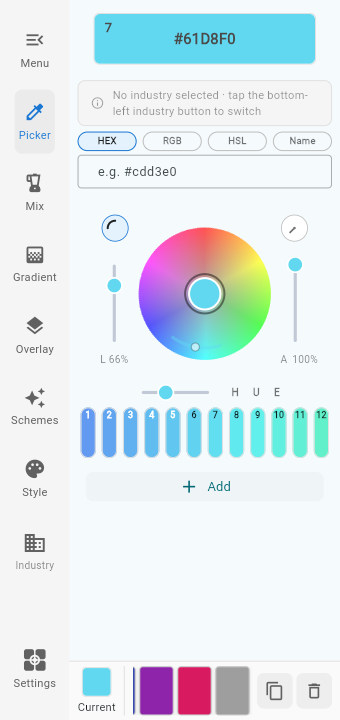

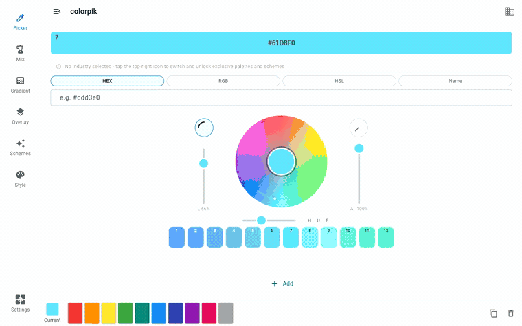

---

## 2. The problem

Choosing a base color is easy. Choosing the *second* color is where most people stall.

Designers, shop owners and illustrators routinely need a palette that works — a poster, a storefront banner, an app UI, a set of nail designs. Most tools hand you a wheel and leave the hard part to you: how much darker should the shade be? Which complement actually reads well next to this one? Will the text be legible on that background?

colorpik closes that gap. It pairs a precise picker with a color-science layer and domain-specific presets, so every color you need is derived from the one you chose — not guessed.

---

## 3. Core idea

**Industry → base color → everything else.**

1. **Pick an industry.** General, painting, fashion, home decor, UI design, e-commerce or nail art.
2. **Pick a base color.** Hue around the wheel, saturation vertically, then fine-tune lightness and opacity.
3. **Let the tool derive the rest.** The picker swatches, the Style palette library and the Schemes suggestions all switch to that industry's color logic.

One decision cascades into a complete, coherent palette.

---

## 4. Modules

### 4.1 Picker

The picker is the heart of the app.

- **Hue around the wheel, saturation vertically** — grab the hue you want, then slide outward for saturation.
- **Switchable hue range** — a short range for fine control, a long range for a full sweep.
- **Four sliders** — the bottom slider sets the hue / saturation segment length; the left and right sliders adjust lightness and opacity.
- **Neighbor swatches** — a 12-swatch row (expandable to 24) shows nearby steps of the current color, ready to tap.
- **Type or search** — enter HEX, RGB, RGBA, HSL or HSLA directly, or search a color by name.
- **Copy anywhere** — tap or long-press any color card to copy it as HEX, RGB, RGBA, HSL or HSLA.

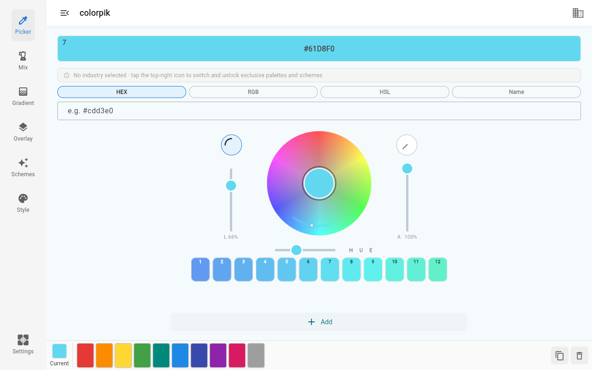

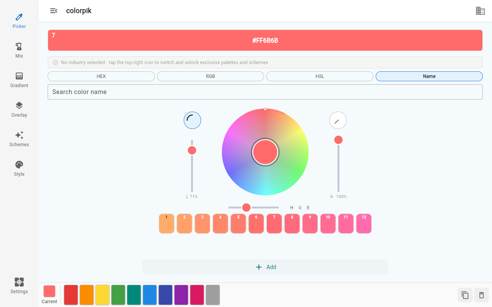

### 4.2 Mix

Blend several colors by their own ratios into one new color.

- **2 to 4 inputs**, each with its own ratio.
- **Two blend spaces** — perceptual (OKLCH: linear luminance, shortest hue path) or numeric (sRGB: the classic midpoint). Compare them side by side and pick the one that suits the job.
- **Result lock** — freeze the mixed color, then keep adjusting any other input. colorpik back-solves the remaining one so the result stays exactly the same. Adjusting proportions becomes a controlled, reversible operation instead of a re-do.

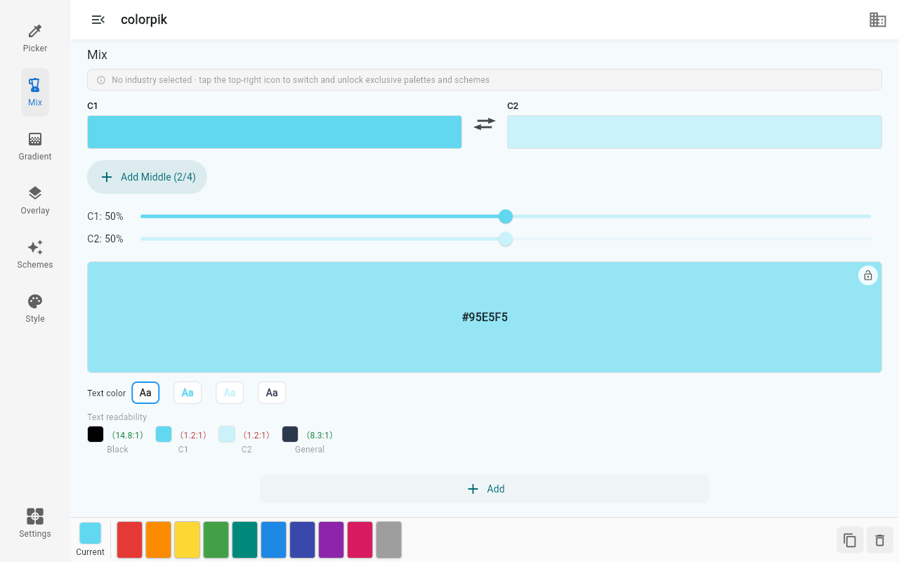

### 4.3 Gradient

Transition between colors and generate the in-between stops.

- **Multi-stop ramps** with an adjustable segment count.
- **Adjustable angle** for directional gradients.
- **Perceptual or numeric interpolation**, same as Mix.
- **Tap a stop to select it**, then add it to the palette — or add every segment at once.

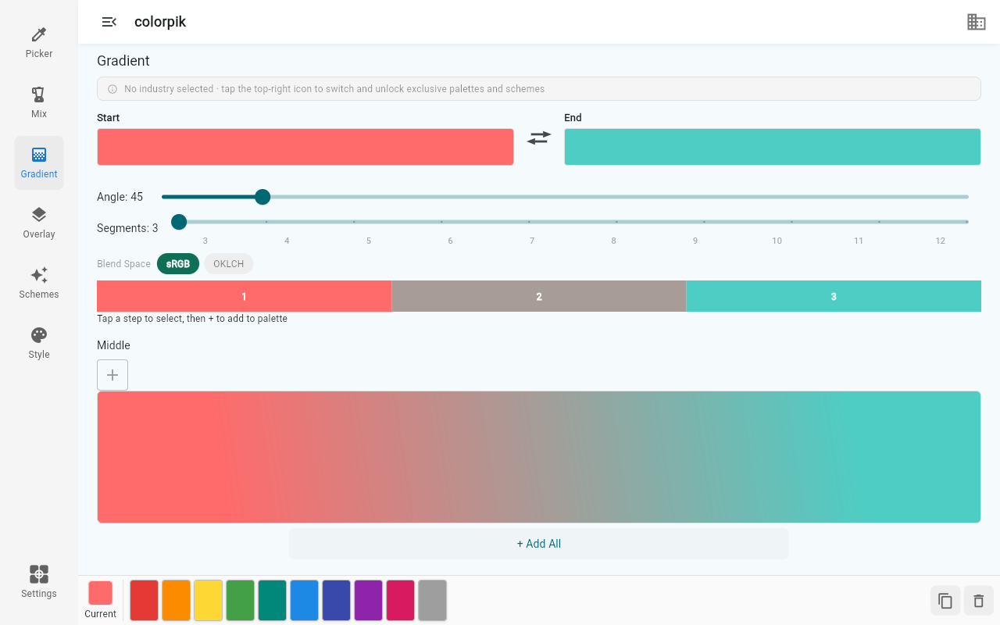

### 4.4 Overlay

Stack colors the way a designer actually thinks about them.

- **The top layer carries its own opacity.** A different opacity lets a different amount of the layer below show through — glazing, tinting, and shadow all become one operation.
- **Presets** for common effects: glaze, lighten, darken, tulle, layering, clash, sunlight, warm light, shadow, vignette, gold leaf and more.
- **Physically correct blending** — compositing is done in linear-light space, so results hold up in production.

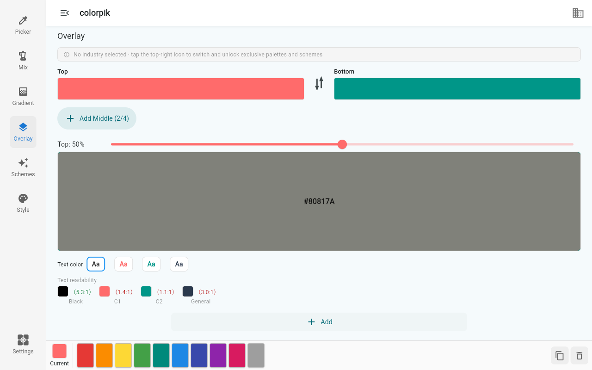

### 4.5 Schemes

Generate harmonious schemes from the current color.

- **Harmony types** — analogous, complementary, triadic, split-complementary, tetradic and monochrome.
- **Industry schemes** — each industry ships with fixed, hand-tuned schemes and a short tip explaining when to use them (e.g. "60-30-10 rule", "wall / ceiling / floor 6:3:1").
- **Layout preview** — see the palette applied to a real layout before you commit to it.

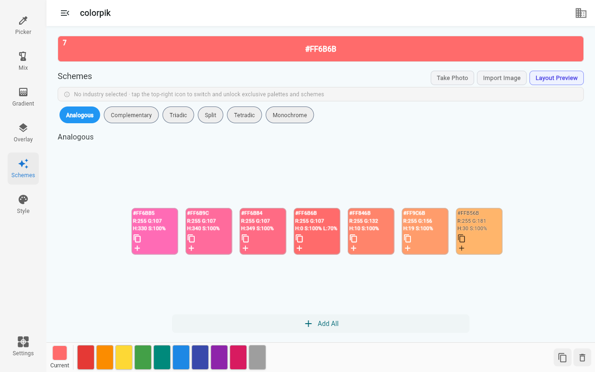

### 4.6 Style

Thirty-plus curated color-family styles, each with its own palette set:

Morandi · cream · macaron · dopamine · healing · Hong Kong style · wabi-sabi · wafu (Japanese traditional) · earth tones · forest · salt (minimal) · cool · Klein blue · Chinese traditional · Monet · Korean traditional · industrial · Y2K · autumn/winter · spring/summer · Mediterranean · Maillard · American vintage · Memphis · cyberpunk · Nanyang · Moroccan · pop art · impressionist · Mondrian · minimalist · French vintage.

Pick a style, and the panel fills with that family's colors — a fast route to a look that reads as intentional.

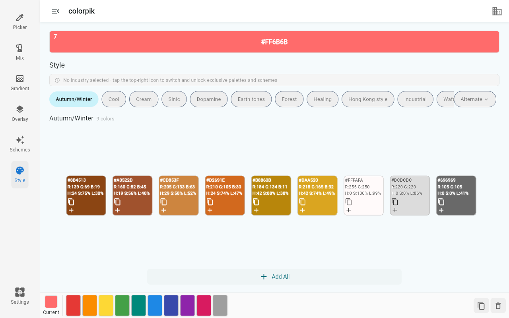

### 4.7 Industry

Seven presets, each of which rewires the whole app:

| Industry | Focus |
| --- | --- |
| **General** | Domain-neutral design |
| **Painting** | Low-saturation natural colors for fine art |
| **Fashion** | Seasonal colors and tonal families |
| **Home Decor** | Low-gray tones and large-area color |
| **UI Design** | Interface system colors, primary and neutral ramps |
| **E-commerce** | High-saturation clashing colors that make prices pop |
| **Nail Art** | Nude and soft tones with restrained accents |

Switching industry updates the picker swatches, the Style palette library and the Schemes suggestions in one tap — and reverting to General restores the defaults.

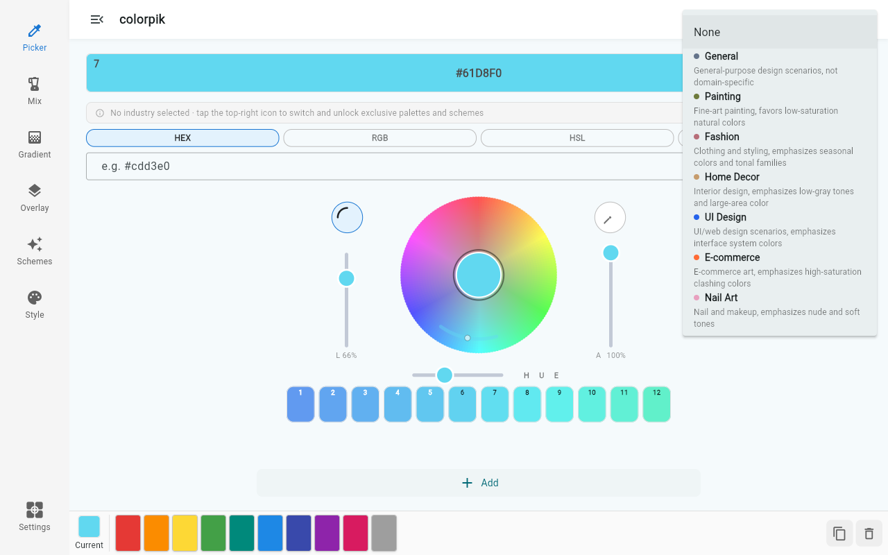

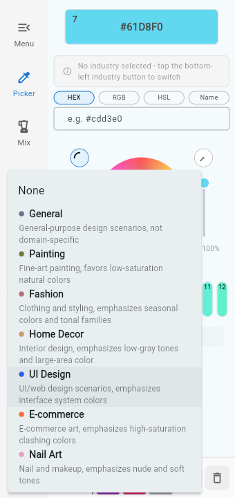

---

## 5. Image picking & layout preview

Sometimes the color is already in front of you.

- **Import or capture** a photo, and it is placed into the layout preview automatically — on the left in landscape, on top in portrait.
- **Extract colors** to pull the dominant colors from the image and fill them into the grid, in order.
- **Similar colors merge automatically**, so an unfilled grid is normal — you get the colors that actually matter, not a noisy average.
- **Add per cell or all at once** — use the "+" on a cell to add one color, or "Save & add" to take them all.
- On desktop, or when camera permission is denied, capture falls back to the photo library.

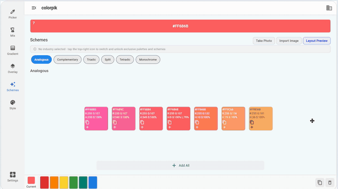

Higher quality: [preview-demo.mp4](assets/videos/preview-demo.mp4)

---

## 6. Color science

colorpik does not hide its math. Every judgment is computed, and where a result is ambiguous the app shows both answers.

**Readability — WCAG 2.1**
Contrast ratios from 1:1 to 21:1, with AA / AAA pass-fail for body and large text, and an automatic best-text-color suggestion. You can see at a glance whether white or black text will hold on a given background — before it reaches production.

**Perceptual interpolation — OKLab / OKLCH**
Interpolating in sRGB makes midpoints go dark and complements go gray. colorpik offers OKLCH interpolation — linear luminance, shortest hue path — so a gradient between two colors stays vivid and even.

**Physically correct compositing**
Alpha blending is computed in linear-light space rather than gamma space, matching what the physics says rather than what the browser defaults to.

**Area-ratio guidance**
A built-in 60 / 30 / 10 weighting check (wall / ceiling / floor, or primary / secondary / accent) computes the weighted overall luminance of a palette and tells you plainly when it reads too dark ("small spaces feel oppressive — raise the large-area color above 0.6 luminance") or too light ("no grounding dark — put a deep color in the accent zone").

---

## 7. Export & palettes

- **Save named palettes locally** and restore any of them with one tap.
- **Export a PNG color card** containing exactly the sections you choose: picker, mix, gradient, overlay and grid.
- **Preview before export**, and edit the save path and file name directly.
- **Undo** the last deletion at any time.

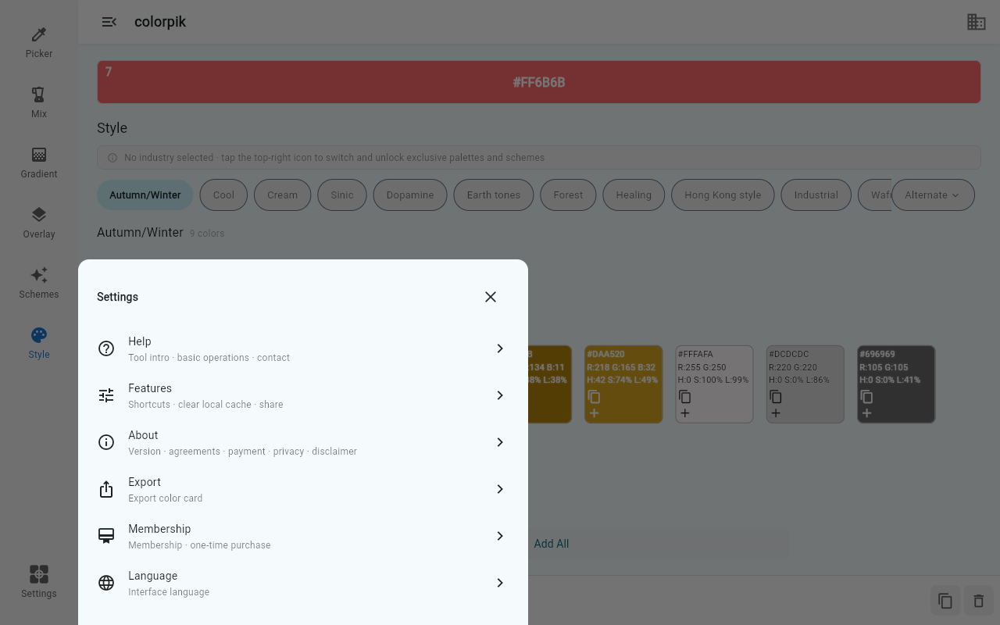

---

## 8. Everywhere you work

One codebase, three tuned layouts:

| Tier | Layout |
| --- | --- |
| **Phone** | Portrait-first, full-screen PWA — installs to the home screen and runs without browser chrome |
| **Tablet** | Wheel and panels resized for the larger canvas |
| **Desktop / laptop** | Multi-column layout with the full toolbar |

Layouts are tuned per screen size rather than scaled wholesale, so the wheel, sliders and swatches stay aligned at any resolution — including short laptop screens and wide desktop monitors.

| Phone — Mix | Phone — Gradient | Phone — Overlay | Phone — Schemes | Phone — Style |
| --- | --- | --- | --- | --- |
| 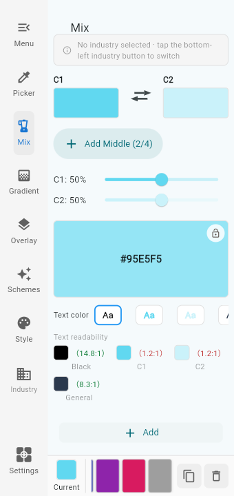 | 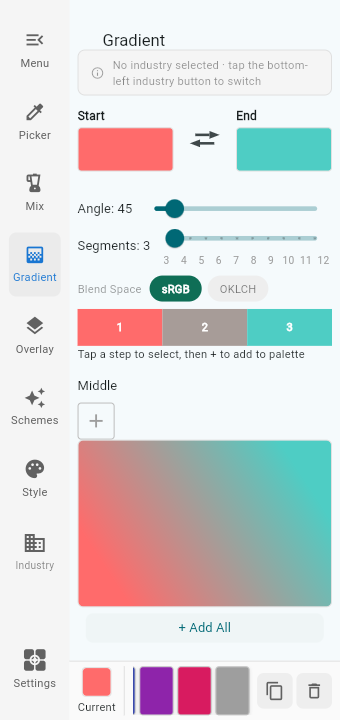 | 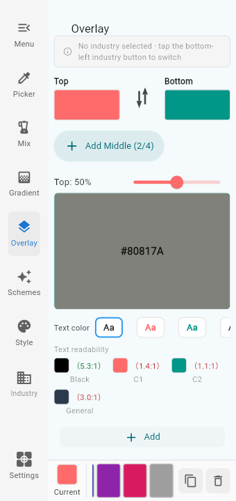 | 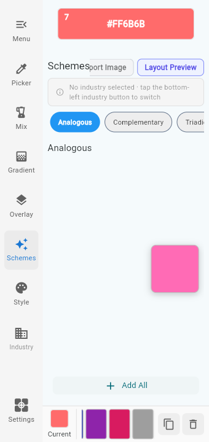 | 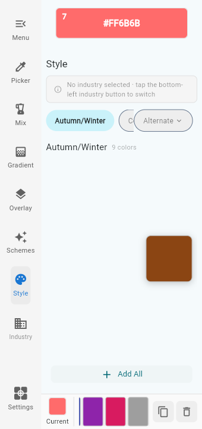 |

---

## 9. Languages

English · 简体中文 · 日本語 · 한국어

All four are complete UI translations, covering the interface, the industry data and the color names.

---

## 10. Privacy

**Your colors stay on your device.**

Palettes, saved colors and preferences are stored locally. There is no account, no sign-up, and no personal information collected. The web app works fully offline once loaded.

---

## 11. Pricing

All features are free to use today.

A **Pro membership** is in preparation. It is planned as a one-time purchase (no subscription) and will include export, unlimited palettes and future Pro features.

---

## 12. FAQ

**Do I need an account?**
No. colorpik works immediately and stores everything locally.

**Does it work offline?**
Yes — once the web app is loaded it runs entirely on your device.

**Which color formats are supported?**
HEX, RGB, RGBA, HSL and HSLA — both for input and for copying.

**Can I use the palettes commercially?**
The exported palettes are yours to use in your own projects. The app itself is licensed for personal, non-commercial use.

**Why do colors look slightly different on another device?**
Displays vary. colorpik computes correct values, but always verify a final color on the target device before production.

---

## 13. Contact

Questions, bug reports or feature requests: **colorpik25@outlook.com**